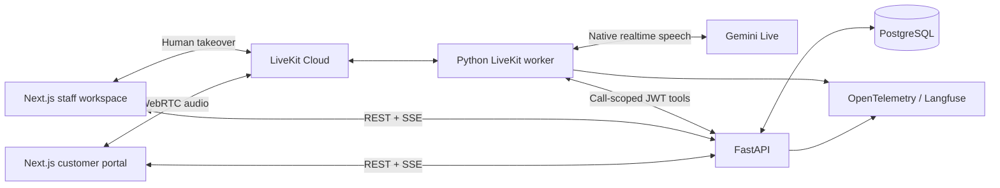

# Architecture and contracts

## Trust boundaries

- The browser receives only a short-lived room-scoped LiveKit token and a session CSRF token. It never receives Google or LiveKit server credentials.
- Session cookies are HTTP-only, SameSite=Lax, eight-hour server-side sessions. Logout revokes the server-side session. Authenticated writes require CSRF and an allowed Origin. Demo deployment uses HTTP on loopback; non-demo mode requires secure cookies and a unique secret.
- Passwords are Argon2-hashed. Login attempts are bounded per source IP in this single-API-process demo; use shared rate limiting before running multiple API instances publicly.
- The API dispatches an explicitly named worker with signed credentials bound to one call. Tool routes derive customer identity from that call. Customer-supplied IDs do not change the credential's scope.
- JWT epochs invalidate tools when a call ends or a human takes over. Separate lifecycle routes allow the original trusted worker to report disconnects and late transcripts without business authority.
- Business writes occur only in the API. The model has prepare tools; only the customer's authenticated portal can confirm. The AI has no refund-decision endpoint.

## State and transactions

Call lifecycle: `connecting → active → handoff_pending → human_active → ended`, with `failed` available for dispatch/model failures. Timed-out handoff returns to `active`; a completed human takeover never automatically returns to the AI.

Escalation lifecycle: `queued → claimed → connecting → active → completed`. Pending stages can become `unavailable` after 60 seconds or `cancelled` on customer exit. A staff disconnect after takeover changes the connection flag, preserving assignment for reconnect.

The assigned staff participant publishes a microphone track with capture disabled. The worker checks room membership and the audio publication, disables AI audio, interrupts active generation, and posts its acknowledgment. The API then marks `human_active` and increments the credential epoch. The staff UI polls for that committed state before enabling capture. Verified LiveKit webhooks can also establish media presence; browsers cannot assert it themselves.

Action lifecycle: `pending → completed`, or `superseded`, `cancelled`, expired by timestamp. One call's latest proposal is the only confirmable action. Confirmation locks call, customer and action rows, rechecks rules, consumes verified authority, creates the resource and stores the result in one transaction. PostgreSQL uniqueness constraints prevent duplicate whole-order returns/refunds. Identical confirmation replay returns the stored result.

Refund lifecycle: `pending_approval → approved → processing → completed`, or `rejected`. Seeded historical data additionally contains `failed`. Staff decisions are locked and require a reason; a dedicated maintenance loop simulates processing. Refund amounts always come from the order total, never from tool arguments.

Lock ordering is call before escalation for timeout, takeover, and hangup paths. Staff claim uses an atomic conditional update so only one claimant wins. Browser updates are backed by committed audit events; SSE reconnect triggers a complete refresh, with a five-second refresh fallback.

## Principal HTTP interfaces

| Interface | Purpose and authority |
| --- | --- |
| `POST /auth/login`, `GET /auth/me`, `POST /auth/logout` | Customer/staff sessions and CSRF bootstrap |
| `GET /portal` | Current customer's orders, return/refund state, tickets and calls |
| `POST /calls` | Own call creation, room creation, explicit agent dispatch, join token |
| `GET /calls/{id}`, `POST /calls/{id}/end` | Owned call review/hangup; staff can review |
| `POST /calls/{id}/verification` and `/verification/complete` | Expiring demo challenge for the authenticated customer |
| `POST /calls/{id}/actions/{action_id}/confirm` or `/cancel` | Exact-action customer confirmation/dismissal |
| `GET /events` | Authenticated audit-based refresh stream scoped to the account |
| `GET /staff/dashboard`, `/staff/customers/{id}` | CRM and support history |
| `PATCH /staff/customers/{id}`, `/staff/tickets/{id}` | CRM notes/language and assigned ticket status/notes |
| `POST /staff/returns/{id}/receive` | Staff inspection receipt |
| `POST /staff/refunds/{id}/decision` | Human-only approve/reject with reason |
| `POST /staff/escalations/{id}/claim` and `/join` | Atomic assignment and assigned-staff room token |
| `GET /staff/analytics`, `/staff/calls/{id}/audit` | Metrics, handoff states and tool audit evidence |
| `/internal/context`, `/internal/knowledge`, `/internal/actions`, `/internal/escalate` | Call-scoped voice tools |
| `/internal/handoff/media`, `/internal/handoff/ack` | Trusted worker media observation and audio-stop acknowledgment |
| `POST /webhooks/livekit` | Signed, deduplicated LiveKit lifecycle events |

See [openapi.json](openapi.json) or `/docs` on the running API for exact request/response schemas. Frontend data types are generated from response models, not copied by hand.

## Voice behavior and failure handling

The Google plugin is pinned through `uv.lock`; the installed SDK's `google.realtime.RealtimeModel` is used with the explicit Gemini model, audio transcription enabled, minimal thinking and native turn detection. The session disables video, text input, remote session control and audio recording. No production STT or TTS provider runs alongside Gemini.

Every tool operation has a five-second total deadline, including one read/idempotent-write retry. Write retries retain the original request ID. Authorization/business failures are returned as failed tool results. Transient failures never become invented success statements. Background context polling is excluded from tool latency and tool-selection counts.

Model transcripts can be late. The UI shows them when available and labels interrupted assistant messages. Late transcript events remain accepted from the original scoped worker after hangup. Call summaries preserve the issue, committed actions and handoff outcome. Handoff summaries are grounded in the agent's current context; no previous call is automatically loaded into a new model session.

The worker observes disconnect events for local operation. Webhooks provide server-side backup when the API is reachable from LiveKit Cloud. The API expires abandoned startup attempts after two minutes. Human audio is outside transcript collection in this version.

## Deferred production work

This is a single-store, local demo with simulated money. Public deployment needs HTTPS, managed secrets, distributed login limits, retention/deletion jobs, provider quotas/capacity monitoring, durable cleanup/reconciliation after process crashes, production identity verification and payment/warehouse integration. PostgreSQL is the concurrency source of truth; SQLite is an exploration/test convenience. API-owned hybrid RAG and the reviewed corpus are documented in [KNOWLEDGE_BASE.md](KNOWLEDGE_BASE.md).

Official references: [LiveKit Gemini](https://docs.livekit.io/agents/models/realtime/gemini/), [agent dispatch](https://docs.livekit.io/agents/server/agent-dispatch/), [testing](https://docs.livekit.io/reference/developer-tools/livekit-cli/agent/testing/), [Google model](https://ai.google.dev/gemini-api/docs/models/gemini-3.1-flash-live-preview), [Langfuse OTLP](https://api.reference.langfuse.com/).

## Hybrid retrieval update

The existing call-scoped `/internal/knowledge` endpoint now retrieves versioned document chunks with pgvector cosine search and PostgreSQL English full-text search, fused by RRF. Embedding 2 creates 768-dimensional multilingual vectors in the API. The worker keeps its existing HTTP tool and receives source provenance, bounded snippets, live catalog facts and the backend policy contract. Model spaces cannot be mixed; changed sources/business rules require review and atomic reindexing. See [the knowledge guide](KNOWLEDGE_BASE.md) for schema, migration, indexing, fallback, telemetry and evaluation behavior.
